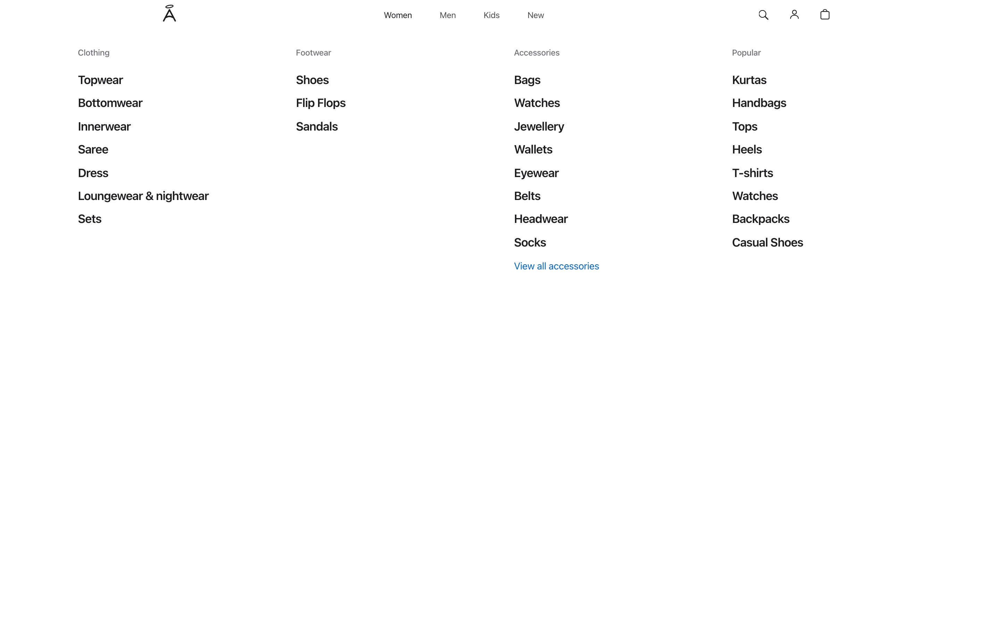
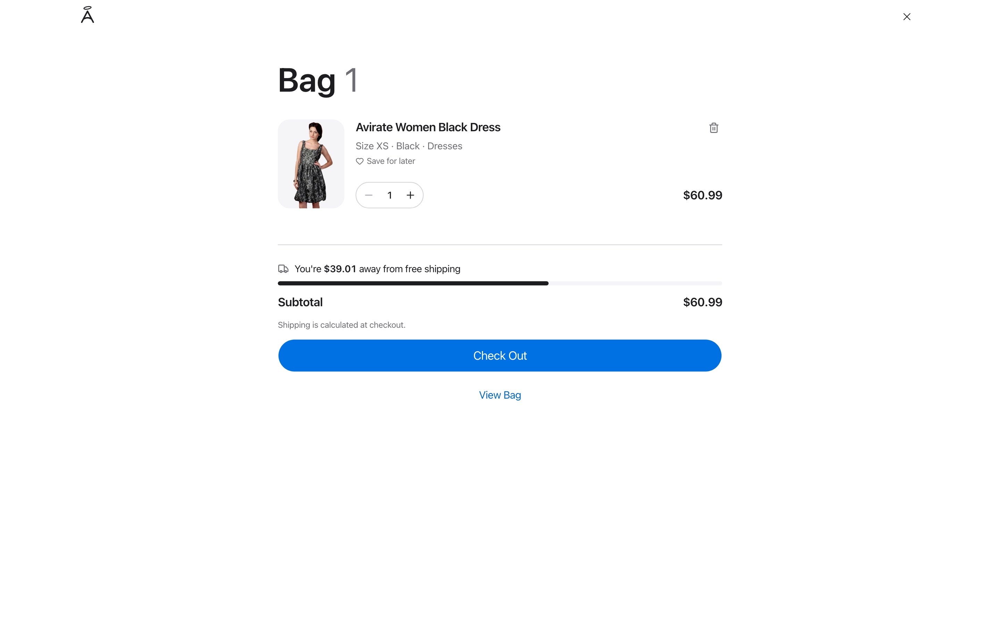

# Angel

[](https://github.com/Iluminimal/diploma/actions/workflows/ci.yml)
[](LICENSE)

**Зургаар хувцас хайх.** Хувцасны зургаа оруулах эсвэл камераар авахад Angel харагдах байдлаараа төстэй бараануудыг
олж харуулна. Бүрэн онлайн дэлгүүрийн дотор ажилладаг бөгөөд загвар нь apple.com-ийн дизайныг дагасан.


| Ангиллын цэс | Сагс | Утсан дээрх хайлт |
| --- | --- | --- |
|  |  |  |

## Боломжууд

- **Зураг, текст эсвэл хоёуланг нь ашиглан хайх** (41,885 бараа)
- **Дэлгүүр**: ангилал, шүүлтүүр, сэтгэгдэлтэй барааны хуудас, хүслийн жагсаалт, сагс, төлбөр, захиалгын түүх
- **Бүртгэл**: и-мэйл эсвэл утсаар нэг удаагийн кодоор нэвтрэх, Google-ээр нэвтрэх
- **Админ самбар**: статистик, захиалга, бараа, нөөц, хэрэглэгч, сэтгэгдэл хянах

## Хэрхэн ажилладаг вэ

Барааны зураг бүрийг [FashionCLIP](https://huggingface.co/patrickjohncyh/fashion-clip) загвар 512 тооноос бүрдсэн вектор
болгож, pgvector-тэй PostgreSQL-д хадгална. Хайлтад оруулсан зургийг мөн адил вектор болгоод, өгөгдлийн сан хамгийн ойрхон
бараануудыг буцаана.

## Ашигласан технологи

| | |
| --- | --- |
| Web | Next.js 16, React 19, TypeScript, Tailwind CSS v4, shadcn/ui, TanStack Query |
| API | Python 3.12, FastAPI, Pydantic v2, SQLAlchemy 2 (async), Alembic |
| Өгөгдөл | PostgreSQL + pgvector, Redis |
| ML | PyTorch дээрх FashionCLIP |
| Хэрэгсэл | uv, Ruff, mypy, ESLint, Vitest, Playwright, GitHub Actions |

## Эхлэх

Шаардлагатай: [Node.js](https://nodejs.org) 24, [uv](https://docs.astral.sh/uv/), Docker (Compose v2), `make`.

```bash
make install   # API болон web-ийн сангуудыг суулгах
make infra     # Postgres, Redis-ийг Docker-т асаах (анх удаа .env үүсгэнэ)
make migrate   # өгөгдлийн сангийн хүснэгтүүдийг үүсгэх

make api       # 1-р terminal: API  http://localhost:8000
make web       # 2-р terminal: web  http://localhost:3000
```

<http://localhost:3000> хаягаар нээнэ. Өгөгдөл ачаалахаас өмнө каталог хоосон байна:

```bash
make ingest ARGS="--limit 500"   # Kaggle fashion датасетийн 500 барааг ачаалах
```

Эхлээд `.env` дахь `DATASET_DIR`-д датасетийн фолдерын замыг зааж өгнө. Дэлгэрэнгүй: [`docs/ml-pipeline.md`](docs/ml-pipeline.md).
Админ самбарыг турших: `make create-admin EMAIL=you@example.com`, дараа нь <http://localhost:3000/admin> хаягаар орно.

## Түгээмэл командууд

| Команд | Юу хийдэг вэ |
| --- | --- |
| `make test` | API болон web-ийн тест |
| `make lint` / `make typecheck` | Ruff + ESLint / mypy + TypeScript шалгалт |
| `make e2e` | Playwright end-to-end тест |
| `make help` | Бүх командын жагсаалт |

## Folder-ийн бүтэц

```
apps/
  api/                   Backend (FastAPI)
    src/angel/
      api/v1/            Route-ууд: хүсэлт хүлээн аваад service рүү дамжуулна (бизнес логикгүй)
      services/          Бизнес логик
      repositories/      Өгөгдлийн сангийн хүсэлтүүд (SQL)
      models/            Өгөгдлийн сангийн хүснэгтүүд (SQLAlchemy)
      schemas/           API-ийн оролт/гаралтын хэлбэр (Pydantic)
      ml/                FashionCLIP, зураг боловсруулалт, категори таних
      ingestion/         Датасетийг ачаалах код
      core/              Тохиргоо, аюулгүй байдал, алдаа, лог
      oauth/, payments/  Google нэвтрэлт, төлбөр
      cli/               Админ үүсгэх, demo өгөгдөл зэрэг команд
    migrations/          Alembic (өгөгдлийн сангийн өөрчлөлтүүд)
    tests/               Тест (src-тэй ижил домэйнээр бүлэглэсэн)
  web/                   Frontend (Next.js)
    src/app/             Хуудас, route-ууд
    src/features/        Үйлдэл бүрийн код (catalog, search, cart, checkout, admin ...)
    src/components/      Олон газар ашиглах UI хэсгүүд (layout, ui, product)
    src/lib/             API клиент, туслах функцүүд
    e2e/                 Playwright тестүүд
scripts/                 Датасет ачаалах, demo өгөгдөл, хэмжилтийн скриптүүд
infra/                   Postgres, Redis-ийн Docker Compose
docs/                    Баримт бичиг (англиар), зураг, хэмжилтийн үр дүн
```

Backend-ийн давхарга: `routes → services → repositories → models`. Давхарга бүрт ижил домэйнүүд
(accounts, catalog, commerce, reviews, admin, system) байна. Дэлгэрэнгүйг [`docs/architecture.md`](docs/architecture.md)-аас харна уу.

## Баримт бичиг

Эдгээр нь англиар бичигдсэн:
[Архитектур](docs/architecture.md) · [Хөгжүүлэлтийн гарын авлага](docs/development.md) · [Шаардлага](docs/SPEC.md) ·
[Хайлтын API](docs/search-api.md) · [ML pipeline](docs/ml-pipeline.md) · [Худалдаа](docs/commerce.md) ·
[Frontend](docs/frontend.md) · [Админ](docs/admin.md) · [End-to-end тест](docs/e2e.md)

## Лиценз

[MIT](LICENSE)
